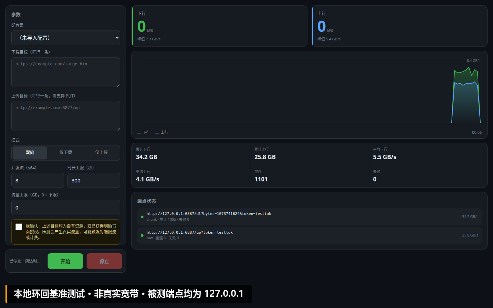

# fnspeed · 飞牛 fnOS 带宽压测应用

[](https://github.com/Jettype/fnspeed/releases/latest)
[](https://github.com/Jettype/fnspeed/actions/workflows/ci.yml)
[](LICENSE)
[](https://go.dev)

双向并发带宽压测。Go 单二进制（CGO 关闭、静态链接），前端单页内联，运行时零依赖。

装到飞牛 fnOS 上，用可动态增减的 HTTP 并发流把上行 / 下行链路压满，实时画出速率曲线，
并按「本机 / 链路 / 目标端」三层给出瓶颈结论。现成的在线测速只能打单一测速点、且被运营商
优化过，测不出跨地区跨运营商的真实表现——这是它存在的理由。



<sub>桌面布局。此图为**本地环回**基准（端点均指向 127.0.0.1），数字不代表真实宽带。</sub>

> **免责声明｜仅限自有或已获授权的链路**
>
> 本项目用于**自有或已获明确授权**的链路测速。向未授权的站点、机房或第三方服务施压，
> 可能违反当地法律与目标站点的使用条款，并产生真实流量费用。使用者承担全部责任，
> 作者不提供任何担保。

## 能做什么

| 能力 | 说明 |
|---|---|
| **动态并发** | 4 条起爬，吞吐涨幅 ≥5% 就继续加，拐点处自动锁定（上限 64），千兆链路也能跑满 |
| **抗锯齿曲线** | 每条流随机 Range 起点 + 重连抖动，不会所有流同时读到文件末尾然后集体归零 |
| **多源覆盖** | 按负载分配 + 覆盖优先补流，11 条源 45 秒内全部点亮，末端源不再 0 字节 |
| **定向测速** | 88 个「省 × 运营商」位置，通过 ECS 解析 + 强制拨号打指定地区的 CDN 节点 |
| **四层自检** | DNS → TCP → TLS → HTTP 逐层定位「连不上」，并显示真实生效的 DNS / 网关 / 代理 |
| **三层归因** | 本机 / 链路 / 目标端，用 CPU、丢包、抖动、补偿次数直接给出瓶颈结论 |
| **隐私** | 出口与命中 IP 只在内存，不落任何日志或配置文件；一键关闭后服务端不再发外部请求 |

## 快速开始

**装到 NAS（推荐）**

1. 到 **[Releases](https://github.com/Jettype/fnspeed/releases/latest)** 下载对应架构的 `.fpk`：

   | 包 | 适合的机器 |
   |---|---|
   | `fnspeed_x86_*.fpk` | N100 / J4125 / N5095 及多数成品 NAS（x86_64） |
   | `fnspeed_arm_*.fpk` | 瑞芯微 RK3588 / 树莓派等 arm64 机型 |

   不确定就看 NAS 的「系统信息 → 处理器架构」，或 `uname -m`（`x86_64` 选 x86，`aarch64` 选 arm）。

2. 飞牛应用中心 → 手动安装 → 选包。升级会保留 `user.json`（自建源、隐藏列表）
3. 装完图标不刷新时执行 `sudo systemctl restart trim_app_center.service`
4. 浏览器打开 `http://<NAS-IP>:8976`

**从源码构建**

```bash
bash build.sh
# 产出 dist/fnspeed_x86_<VER>.fpk 与 dist/fnspeed_arm_<VER>.fpk
```

依赖 Go ≥ 1.21、python3 + Pillow（仅用于生成图标）。无第三方 Go 依赖，不需要 `go mod download`。

**上行压测需要接收端**：公网没有可直接写的端点，需自建 `sink/`（独立模块，含 `-rate`
限速模拟）。默认预设里只有 `127.0.0.1:8977` 占位。

## 文档

| 文件 | 内容 |
|---|---|
| [docs/INSTALL.md](docs/INSTALL.md) | 安装、桌面入口与网关反代、图标排查、接收端部署、构建与验收 |
| [docs/CONFIG.md](docs/CONFIG.md) | 文件树、配置持久化与格式、15 个内置测速源 |
| [docs/DESIGN.md](docs/DESIGN.md) | 调度策略、定向测速、传输模式、稳定性、已知限制、安全边界 |
| [CHANGELOG.md](CHANGELOG.md) | 各版本改了什么、为什么改（含已缺失的 1.5.2） |
| [CONTRIBUTING.md](CONTRIBUTING.md) | 硬约束、新增测速源门槛、测试守着哪些不变量 |
| `PLAN-1.5.1.md` | 1.5.1 开工清单，历史文档，留作决策记录 |
| `sink/` | 接收端源码，部署步骤见 [docs/INSTALL.md](docs/INSTALL.md#7-部署接收端上传测试必需) |

## 许可

[MIT](LICENSE)。测速源预设指向的第三方 CDN 与安装包归各厂商所有，本项目只引用其公开下载地址。
